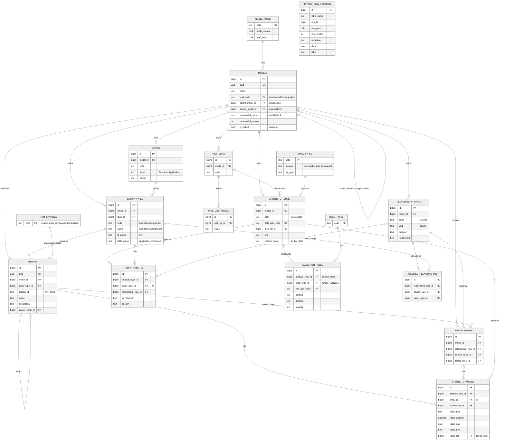
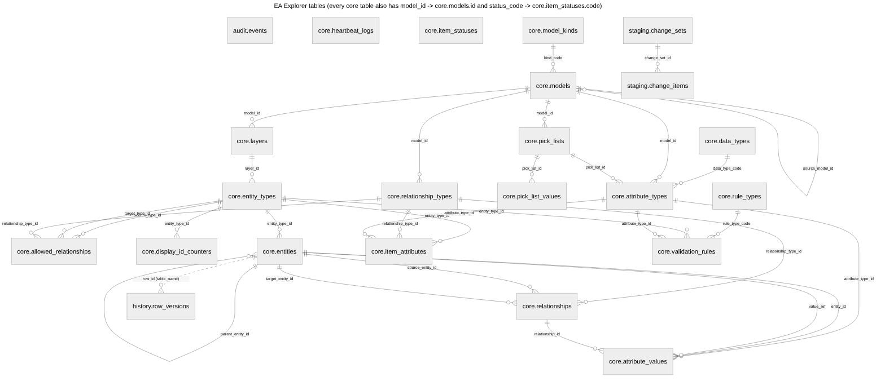

# The repository database



(Diagram source: `images/database-phase1.mmd`, a Mermaid ER diagram. The SQL is
`services/api/migrations/sql/0002_metamodel.sql`.)

Table names are plural (`core.models`, `core.entities`, `core.relationships`...); columns that
point at another table are singular with `_id` (`model_id`, `entity_type_id`).

### Tables and how they join



The same picture is on the SQL window. It is generated from the database's own catalog:
`python docs/images/db-tables-generate.py` (see the script for the two `mmdc` commands that
render it), after any migration that adds or renames tables.

## Where the database scripts are

Everything that creates the database is code in this repository; nothing is created by hand.

| File | What it creates |
| --- | --- |
| `deploy/postgres/initdb/01-databases.sh` | The four databases and their logins (first start of the db container only) |
| `services/api/migrations/versions/0001_foundation.py` | Schemas, the audit log, the staging tables, the heartbeat table and report view |
| `services/api/migrations/sql/0002_metamodel.sql` | Models, metamodel and content tables, integrity rules, history |
| `services/api/migrations/sql/0002_functions.sql` | `eax.get_entity`, `eax.get_entity_by_name`, `eax.drop_entity` |
| `services/api/migrations/versions/0002_metamodel.py` | Runs the two SQL files above (and drops them on downgrade) |
| `services/api/migrations/sql/0003_library.sql` (run by `versions/0003_library.py`) | Schema versions, model properties, locks on templates and reference models, the installer's rights |
| `services/api/migrations/sql/0004_screens.sql` (run by `versions/0004_screens.py`) | Version 0.2.1 only (no schema change) |
| `services/api/migrations/sql/0005_metamodel_editing.sql` (run by `versions/0005_metamodel_editing.py`) | Metamodel versions, attribute defaults, metamodel version on entities, model locks |
| `services/api/migrations/sql/0006_roles.sql` (run by `versions/0006_roles.py`) | EA Explorer's roles and the Keycloak role mapping, model assignments, model ancestors, row-level security and permission triggers |
| `services/api/migrations/sql/0007_relationship_rules.sql` (run by `versions/0007_relationship_rules.py`) | The rule type `has_relationship` (an entity must have a relationship of a type, to or from a type) on the built-in field `relationships` (D113) |
| `services/api/migrations/sql/0008_models.sql` (run by `versions/0008_models.py`) | Phase 4 (0.4.0): the Library Admin role; `library_state` (building, published, withdrawn), `copy_state`, `copy_note` and `history_from_source` on models; `core.copy_model` (a faithful copy of a metamodel, and of content with display IDs); deleting needs Super Admin and is refused while other models depend on the model; `core.metamodel_drafts` (D115, D118, D121) |
| `services/api/migrations/sql/0009_reports.sql` (run by `versions/0009_reports.py`) | Phase 5 (0.5.0): report views in schema rpt read by the report login eax_report through SECURITY DEFINER functions (models, entities, entity_values, relationships, changes, catalogue, entity_pairs, std_roles, entity_std); typed views rpt.t_<type> made by `rpt.refresh_typed_views()` (D139); the thirty standard reports rpt.sr01..sr30 and the model overview rpt.mo_* (D137, D140); model access for reports `rpt.model_access` and `core.known_users` (D138) |
| `services/api/migrations/sql/0010_data_entry.sql` (run by `versions/0010_data_entry.py`) | Phase 6 (0.6.0): `tags` on entities (cleaned by a trigger, copied with copies); `rule_override` on attribute values (D48); `from_content` on allowed relationships and `core.allow_from_content()` (D49: a relationship outside the metamodel adds the mapping as a new metamodel version, flagged); `rpt.entity_tags` |
| `services/api/migrations/sql/0011_grids.sql` (run by `versions/0011_grids.py`) | Phase 7 (0.7.0): `core.saved_views` (grid and list views: columns, filter, sort; private or shared), `core.favourites` (entities, models, views), trigram indexes for search on attribute values and entity names |
| `services/api/migrations/sql/0017_sheets.sql` (run by `versions/0017_sheets.py`) | Phase 10.1 (0.10.1): loads, column mappings, task files |
| `services/api/migrations/sql/0016_settings.sql` (run by `versions/0016_settings.py`) | Phase 10 (0.10.0): `core.settings` (application and runtime settings changed in the administration console, kept in the history; readable by the report login) |
| `services/api/migrations/sql/0015_change_log.sql` (run by `versions/0015_change_log.py`) | Phase 9 (0.9.0): a `tx` column (the writing transaction) and index on `history.row_versions` and `audit.events`, so the change log ships only finished transactions. The change log itself is in its own database (`EAX_CHANGELOG_DB_URL`, schema `changelog`: `entries`, `shipped`), made by `eax/change_log.py` |
| `services/api/migrations/sql/0014_tags.sql` (run by `versions/0014_tags.py`) | Phase 8.3 (0.8.4): `core.model_tags` (frozen snapshots: the metamodel document and every entity and relationship state, a locked tag guarded by a trigger), `core.compare_profiles`, `core.gap_analyses` and `core.gap_items` (TOGAF gap analyses with notes, resolutions, work packages and Gap entities); commits of kind `restore` and `merge`; report views `rpt.gap_analyses`, `rpt.gap_items`, `rpt.gap_matrix` |
| `services/api/migrations/sql/0013_commits.sql` (run by `versions/0013_commits.py`) | Phase 8 (0.8.3): model roles `committer` and `history-viewer`; `core.change_sets` and `core.pending_changes` (uncommitted content changes per author, D165; not readable by the report login), `core.commits` and `core.commit_items` (each item with the target before and after, for roll back), `core.merge_sessions` (a merge's plan); draft models can be `rejected`; `core.why_not` lets Committers change content |
| `services/api/migrations/sql/0012_viewpoints.sql` (run by `versions/0012_viewpoints.py`) | Phase 8.2 (0.8.2): `core.viewpoints` (viewpoints as data; built-in VP-01 to VP-25 fixed by a trigger, organisations' own), `core.report_audiences` and `core.report_audience_links` (D153); report views `rpt.vp_*` (viewpoints), `rpt.tc_*` and `rpt.tm_*` (TOGAF catalogues and matrices), `rpt.type_pairs`, `rpt.dependency_edges`, `rpt.dr_*` and `rpt.f_dependencies()` (dependency reports). The seed (`eax.seed.catalog`) loads the built-in viewpoints and audiences from `eax/report_defs.py` on every start |
| `services/api/tests/sql/sample_history.sql` | Gives Claims Platform in the sample model a history to try the timeline on (changes the sample model) |
| `services/api/eax/jobs_schema.py` | The job queue tables (Procrastinate) |
| `services/api/eax/seed/` | The ArchiMate 4 template, the insurance reference model and the sample model (rows, not structure), loaded by the installer's login |
| `services/api/tests/sql/phase1_checks.sql`, `phase2_checks.sql`, `phase2_installer_check.sql`, `phase3_checks.sql`, `phase3_1_checks.sql`, `phase4_checks.sql` | Checks for all of it, in transactions that are rolled back |

The api container runs them in that order on every start (`entrypoint.sh`: `alembic upgrade
head`, the job tables, then the seed); each step only does what is not done yet. Each later build
phase adds its own numbered migration (`0003_...`) rather than editing an earlier one once that
phase is accepted.

## Versions

The database carries a version in `core.schema_versions` (one row per version, written by the
migration that moves it; `core.schema_version()` gives the newest). The API's version is in
`services/api/version.toml`. They must be equal: the heartbeat and the service health check warn when
they differ. Phase N is version 0.N.0 (phase 3: 0.3.0); additions between phases take a patch number (0.2.1).

## Locked models and the installer's login

Templates and reference models are **locked** (`core.models.is_locked`). Triggers on `core.models`
and on every metamodel and content table refuse any insert, update, delete or truncate that touches
a locked model, and refuse locking or unlocking a model, unless the session's login is
**`eax_migrator`**: the installer's login, created with the database
(`deploy/postgres/initdb/01-databases.sh`, password `EAX_DB_MIGRATOR_PASSWORD`) and used only by the
seed step. The check is on the session's login, so `SET ROLE` does not get round it, and it applies
to the `postgres` superuser too. (A superuser can still switch the triggers off; that is a deliberate
act outside the product.) A new version of a reference model is a new model beside the old one: the
name is unique per `version_label`.

## Metamodel versions (phase 3)

- `core.models.metamodel_version` is the current version; `core.metamodel_versions` has one row per
  published version (model, version, note, who, when). Version 1 is the initial metamodel.
- `core.publish_metamodel_version(model, note)` moves to the next version and sets
  `eax.history_label` to `metamodel vN` for the rest of the transaction, so every history row the
  change writes is labelled with its version. The editor (`eax/metamodel_edit.py`) calls it first in
  every change (D72: one change, one version).
- `core.entities.created_mm_version` and `modified_mm_version` are stamped by the trigger
  `entities_mm_version`.
- `core.item_attributes.default_value` and `help_text`: the default for new entities.
- Removing an attribute or a relationship type sets `is_deleted` on its values or relationships (and
  their values): the history triggers keep each one (D75).

## Notifications, requests, webhooks and push-down (phase 8.1)

- `core.notifications` (kind, category commit/metamodel/request/model, `needs_action`, model, title, body, link, the
  thing it is about in `ref_kind`/`ref_id`, `resolved_at`/`resolved_by`/`resolution`) and
  `core.notification_recipients` (one row per person, with `read_at` and `dismissed_at`). Only notifications that need
  action are resolved (a check constraint); resolving is once for everyone.
- `core.requests` (numbered from 1001; subject, body, sender, receiver, status open/in_progress/done/declined, a
  `close_note` required when done or declined) and `core.request_comments` (comments and status changes). Private to
  the two: the API filters every read by sender or receiver.
- `core.webhooks` (address, kinds, secret, enabled) and `core.webhook_deliveries` (the signed JSON sent, status
  pending/sent/failed, attempts, next try, last answer). The job `eax.deliver_webhooks` runs every minute.
- `core.metamodel_version_changes`: the changes (op, payload, result) each metamodel version was made of in the editor
  and the grids. `core.metamodel_pushes` (from model, versions, forced or offered, fill defaults, note, came from) and
  `core.metamodel_push_targets` (one per model below: offered, applied with the model's own version, rejected with a
  note, failed with the error, skipped when read-only). `core.metamodel_versions_pushed` lists the versions already
  pushed.
- A forced package is made with the parent's authority: `core.why_not` lets the metamodel and the model row of the one
  model named in the transaction setting `eax.push_down` change, which the API sets around that change only (and reads
  the model past row-level security with `eax.rls_bypass`, which counts only for the API's own login).
- `core.change_documents`: a page per accepted change (metamodel package, commit, merge) as JSON sections of rows.
- None of these are in the report login's reach (`eax_report`).

## Model locks (phase 3)

`core.models.lock_level` is `none`, `metamodel`, `content` (metamodel and content) or `maintenance`,
with `lock_reason`, `locked_at` and `locked_by` (stamped by the trigger `models_1_lock_level`; a
locked model must be unlocked before it is locked another way). Triggers `<table>_1_model_lock` on the
nine metamodel tables and the four content tables call `core.refuse_model_lock()`: a metamodel lock
refuses the metamodel tables, a content lock refuses both, a maintenance lock refuses everyone but
`locked_by`. `metamodel_versions_lock` stops a version being published under a lock. The installer's
login passes, as for `is_locked`. They are separate from `is_locked`, the installer's permanent lock
on templates and reference models.

## Roles and permissions (phase 3.1)

- `core.app_roles`: EA Explorer's roles with their `scope`: global (Super Admin, IT Admin, User Admin,
  Keycloak Admin, Model Creator, User) or model (Model Admin, Model Sub Admin, Architect, Report Viewer).
- `core.role_mappings`: which Keycloak role gives which global role (defaults `eax-<role>`); global
  roles are given in Keycloak only (D92). Only global roles can be mapped.
- `core.model_users`: people's roles on a model (model_id, username, role), several per person allowed
  (D96); given by the model's Model Admin. `core.model_ancestors`: every model's ancestors through
  `parent_model_id` and `source_model_id`, rebuilt by a trigger on `core.models` (D60).
- The API sets `eax.actor` and `eax.user_roles` (global roles) on every connection (`eax/db.py`). Empty
  means no user (installer, seed, jobs, an administrator's psql): nothing is restricted. A signed-in
  person with no global role gets `none`.
- Reading: row-level security (`FORCE`, since the API's login owns the tables) on `core.models`,
  `entities`, `relationships` and `attribute_values`: Super Admins read every model; everyone else the
  models they have a role on, their ancestors, and the library (templates and reference models, D98).
  `core.can_read_model()` (used by `eax.get_entity`) asks the same question. `core.assignments()` lists
  every model role for the Users page (User Admins read no model); it uses `eax.rls_bypass` for the
  length of the call, which counts only for the tables' owner.
- Writing: triggers `<table>_00_access` (before the lock triggers) call `core.refuse_unpermitted()`,
  which asks `core.why_not(model, part)`: the metamodel, the model row (locks, properties) and its
  people need that model's Model Admin; content needs its Model Admin, Model Sub Admin or Architect;
  a new model needs Model Creator (or Model Admin of the model it derives from), and its creator
  becomes its Model Admin (D97). `role_mappings` needs User Admin. Super Admin passes everything.
- Checks: `tests/sql/phase3_1_checks.sql`, run as `eax_app`.

## The SQL window

Read-only for everyone (D52): `eax/sqlconsole.py` runs each statement in a transaction that is always
rolled back, so a change shows what it would do and is then undone.

## The idea

The repository is **generic**: one table for entities, one for relationships and one for attribute
values, described by a **metamodel** held in ordinary rows. A new entity type, attribute or
relationship rule is a new row, never a database change. `eax.get_entity` turns the generic rows
back into one ordinary table per type whenever you need it.

The design brings together the original EA-Metamodel-Explorer database diagram and the phase 1
proposal, and goes further than both:

| Taken from the original diagram | Taken from the proposal | Added |
| --- | --- | --- |
| Model kinds (template, project) and a parent model | Generic content with typed value columns (text, number, date, yes/no, link) | Reference models as a kind, and a lock flag for read-only models |
| One status on every item (created, under review, published, retired) | `get_entity` / `get_entity_by_name` and SQL joins between types | Integrity rules enforced by the database (see below) |
| Attribute types defined once and mapped to types (`item_attributes`) | Relationship attributes | Display IDs (APP-0012) numbered per model and type |
| Validation rules | Pick lists | One append-only history table for every table, with labels |
| Parent entity (hierarchies) | GUIDs for copy and merge | bigint keys for speed, guid for identity |
| Created/modified by and when, soft delete, history | | Data types with a storage kind and SQL type |

The original's `Attributes_Pointer` (sharing one value between models) is not used: copies keep
their lineage through `origin_guid` instead, which covers deep copy and merge back without values
changing in two models at once.

## Keys

| Column | On | What it is |
| --- | --- | --- |
| `id` | every table | bigint, the primary key. Every foreign key and join uses it. Internal only. |
| `guid` | every table | uuid, unique and never reused. The API, URLs, exchange files, deep copy and merge back use it. |
| `origin_guid` | every table | the guid of the row this one was copied from (empty for originals). |

## Housekeeping on every table

`status_code` (workflow status), `is_deleted` (soft delete), `created_at` / `created_by`,
`modified_at` / `modified_by` and `row_version` are kept by trigger. The acting user comes from the
setting `eax.actor`, which the API sets for each request.

Every insert, update and delete is copied to **`history.row_versions`**: the table, the row's id and
guid, its model, the version number, the operation and the whole row as JSON. A label (for
example a baseline or import name) is taken from the setting `eax.history_label`. History is
append-only: updates and deletes are refused.

## Models own their metamodel

A **model** holds its own metamodel (layers, entity types, relationship types, attribute types,
pick lists, validation rules, allowed relationships) and its content. Kinds:

| Kind | Content | Read-only | Use |
| --- | --- | --- | --- |
| template | no | yes | a metamodel to start new models from (ArchiMate 4) |
| reference | yes | yes | industry and high-level reference models |
| project | yes | no | a working model |

**Models form a hierarchy of any depth**, and a work copy is not a separate kind: it is a project
model with a parent. Two links on every model:

- **`parent_model_id`**: the model it merges back into. Empty for a top-level model. A copy of a
  copy of a copy is fine; each level merges into the one above it. The parent must be a working
  model (never a template or reference model), and a model can never end up under itself.
- **`source_model_id`**: the model it was created or copied from (lineage only). This can be a
  template or reference model, which can never be a parent.

A work copy usually has the same model as parent and source. Creating a model from a template copies
the metamodel rows; every copy points back through `origin_guid`. The seed does exactly this for
the sample model: its source is the ArchiMate 4 template and it has no parent.

## Integrity enforced by the database

Whatever writes to the database (API, CSV loads, diagram harvest, MCP, plain SQL), these hold:

- A template cannot hold entities.
- An entity's type, parent, relationships and attribute values are all in the same model.
- A relationship must be allowed by the metamodel for its source and target types
  (`allowed_relationships`). Example refusal: *The metamodel does not allow Serving from Data Object
  to Goal*.
- An attribute value must belong to an attribute mapped to the owner's type, sit in the column for
  its data type, be a whole number for whole-number attributes, come from the pick list for list
  attributes, and link only to entities in the same model.
- Display IDs are numbered per model and type (`APP-0001`, `APP-0002`, ...) when not given.

Validation rules (`validation_rules`: mandatory, ranges, patterns, date order...) are stored now and
applied by the API and the publishing workflow in later phases, because they can be warnings and can
depend on other fields.

## get_entity

You always name the tables; the relationship table gets `_rel` added:

```sql
SELECT eax.get_entity('Application Component', 'apps');                  -- every model you may read
SELECT eax.get_entity('Application Component', 'apps2', '<model guid>'); -- one model
SELECT eax.get_entity_by_name('Capability', 'Claims Management', 'cap');
SELECT eax.get_entity('Capability', 'caps', p_with_relationships => false);
SELECT eax.drop_entity('apps');                                           -- drop apps and apps_rel
```

Each call returns the names of the temporary tables it built:

- **`<name>`**: one row per entity: `id`, `guid`, model, `display_id`, `name`, `description`,
  parent, `status`, then one column per attribute of the type, typed by its data type (a link to
  another entity gives its name, plus `<column>_id`), then the housekeeping columns.
- **`<name>_rel`**: one row per relationship end: the entity, relationship type and verb,
  `direction` (outgoing or incoming), the other entity (id, guid, type, display ID, name) and the
  relationship's attributes as JSON.

Names are lower-case letters, digits and underscores (at most 59 characters). A name already used
in the session is refused, never replaced, so two calls cannot overwrite each other; our code uses
a fresh guid-based name for every call (`e_` + 32 hex digits). The tables are temporary: private to
the session and dropped by PostgreSQL when the connection closes. The API drops them itself before
returning, and its connection pool runs `DISCARD TEMP` whenever a connection goes back, so none
outlive the request.

The type can be given by name (`Application Component`), code (`ApplicationComponent`) or table name
(`application_component`), in any case. Two or more calls join like ordinary tables, through the
relationship table:

```sql
SELECT eax.get_entity('Application Component', 'apps');
SELECT eax.get_entity('Capability', 'caps', p_with_relationships => false);
SELECT eax.get_entity('Data Object', 'data', p_with_relationships => false);

-- each capability, the applications that realise it, their cost and the data they use
SELECT c.name AS capability, a.name AS application, a.lifecycle, a.hosting, a.annual_cost,
       string_agg(d.name, ', ' ORDER BY d.name) AS data_used
  FROM caps c
  JOIN apps_rel rc ON rc.other_entity_id = c.id AND rc.direction = 'outgoing'
                  AND rc.relationship_type = 'Realization'
  JOIN apps a      ON a.id = rc.entity_id
  LEFT JOIN apps_rel rd ON rd.entity_id = a.id AND rd.direction = 'outgoing'
                       AND rd.relationship_type = 'Access'
  LEFT JOIN data d      ON d.id = rd.other_entity_id
 GROUP BY c.name, a.name, a.lifecycle, a.hosting, a.annual_cost
 ORDER BY c.name, a.name;
```

Only models the caller may read are included (`core.can_read_model`, which model roles replace in
build phase 4). Reporting tools use persistent views in the `rpt` schema instead (build phase 5),
because they cannot see another session's temporary tables.

## Checks

`services/api/tests/sql/phase1_checks.sql` checks the seed, `get_entity`, display IDs, history and
every integrity rule against a real PostgreSQL, inside a transaction that is rolled back.
